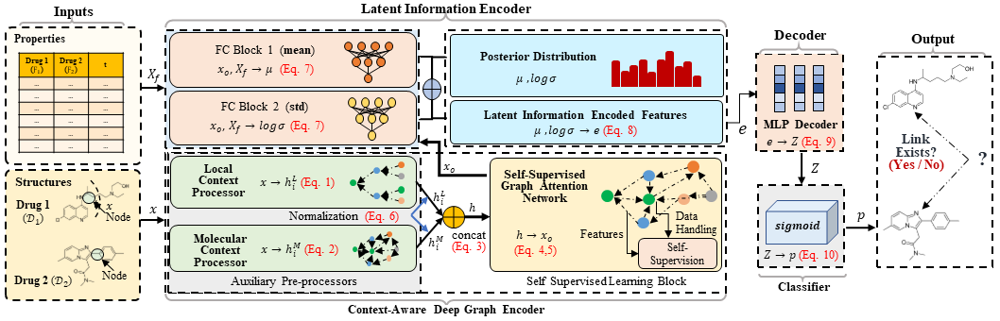

# **CADGL: Context-Aware Deep Graph Learning for Predicting Drug-Drug Interactions**
### Accepted at IEEE Transactions on Computational Biology and Bioinformatics
### [Azmine Toushik Wasi](https://azminewasi.github.io), Taki Hasan Rafi, Raima Islam, Karlo Šerbetar, and Dong-Kyu Chae

---

[](https://doi.org/10.1109/TCBBIO.2026.3675142)
[](https://doi.org/10.1109/TCBBIO.2026.3675142)
[](https://ieeexplore.ieee.org/Xplorehelp/Help_CiteScore.html)
[](https://ieeexplore.ieee.org/Xplorehelp/Help_pub_journals.html#eigenfactor)

---

## Abstract
Examining Drug-Drug Interactions (DDIs) is a pivotal element in the process of drug development. DDIs occur when one drug's properties are affected by the inclusion of other drugs. Detecting favorable DDIs has the potential to pave the way for creating and advancing innovative medications applicable in practical settings. However, existing DDI prediction models continue to face challenges related to generalization in extreme cases, robust feature extraction, and real-life application possibilities. We aim to address these challenges by leveraging the effectiveness of context-aware deep graph learning by introducing a novel framework named CADGL. Based on a customized variational graph autoencoder (VGAE), we capture critical structural and physio-chemical information using two context pre-processors for feature extraction from two different perspectives: local neighborhood and molecular context, in a heterogeneous graphical structure. Our customized VGAE consists of a graph encoder, a latent information encoder, and an MLP decoder. CADGL surpasses other state-of-the-art DDI prediction models, excelling in predicting clinically valuable novel DDIs, supported by rigorous case studies.

---

## Architecture
Pipeline of CADGL.

<p align="center">
  
</p>

---

## Setup and run
To install the dependencies, run:
```
pip install -r requirements.txt
```
To run the training script, place the dataset from DrugBank, go to the `./CADGL/` folder, and run:
```
python train.py
```
To change the number of epochs, go to `./CADGL/config/config.py` and change the value of the variable `num_total_epoch`. The default is 400. Other settings can be found inside the code.

---

## Experimental Findings

#### **Possible Novel Drug-Drug Interactions (Not Clinically Verified Yet)**
| No | Drug 1 ($\mathcal{D}_1$) | Drug 2 ($\mathcal{D}_2$) | Interaction Type (t) | Probability |
|----|---------------------------|---------------------------|-----------------------|-------------|
| 1  | Secobarbital              | Arotinolol                | Drug 2 hypotensive activities increases ($\uparrow$) | 99.883\% |
| 2  | Mesalazine                | Nafamostat                | Drug 2 anticoagulant activities increases ($\uparrow$) | 99.833\% |
| 3  | Voriconazole              | Etoposide                 | Drug 2 Serum Concentration increases ($\uparrow$) | 99.816\% |
| 4  | Risperidone               | Propofol                  | Risk of adverse effects increases ($\uparrow$) | 99.660\% |
| 5  | Pipamperone               | Bupivacaine               | Risk of adverse effects increases ($\uparrow$) | 99.503\% |
| 6  | Moricizine                | Hydralazine               | Drug 2 hypotensive activities increases ($\uparrow$) | 99.491\% |
| 7  | Isoniazid                 | Tazarotene                | Drug 2 Metabolism decreases ($\downarrow$) | 99.420\% |
| 8  | Methylphenobarbital       | Treprostinil              | Drug 2 hypotensive activities increases ($\uparrow$) | 99.366\% |
| 9  | Nevirapine                | Vinorelbine               | Drug 2 Serum Concentration decreases ($\downarrow$) | 99.337\% |
| 10 | Dabrafenib                | Pentamidine               | Drug 2 QTc-prolongation increases ($\uparrow$) | 98.813\% |
| 11 | Acebutolol                | Tramadol                  | Drug 2 therapeutic efficacy decreases ($\downarrow$) | 95.458\% |
| 12 | Carvedilol                | Canagliflozin             | Drug 2 hypoglycemic activities increases ($\uparrow$) | 97.283\% |
| 13 | Mesalazine                | Nafamostat                | Drug 2 anticoagulant activities increases ($\uparrow$) | 99.833\% |
| 14 | Amitriptyline             | Terlipressin              | Drug 2 antihypertensive activities decreases ($\downarrow$) | 98.813\% |
| 15 | Ergocalciferol            | Ajmaline                  | Drug 2 arrhythmogenic fixation increases ($\uparrow$) | 79.270\% |
| 16 | Darifenacin               | Pentamidine               | Drug 2 hypoglycemic activities increases ($\uparrow$) | 83.362\% |
| 17 | Vemurafenib               | Enoxacin                  | Drug 2 serum concentration decreases ($\downarrow$) | 98.806\% |
| 18 | Clodronic acid            | Phenprocoumon             | Drug 2 anticoagulant activities increases ($\uparrow$) | 97.729\% |
| 19 | Cyclobenzaprine           | Crizotinib                | Drug 2 QTc-prolonging activities increases ($\uparrow$) | 95.635\% |
| 20 | Bupranolol                | Penbutolol                | Drug 2 bradycardic activities increases ($\uparrow$) | 78.210\% |

---

## Citation
```
@article{wasi2026cadgl,
   title={CADGL: Context-Aware Deep Graph Learning for Predicting Drug-Drug Interactions},
   author={Wasi, Azmine Toushik and Rafi, Taki Hasan and Islam, Raima and Šerbetar, Karlo and Chae, Dong-Kyu},
   journal={IEEE Transactions on Computational Biology and Bioinformatics},
   year={2026},
   doi={10.1109/TCBBIO.2026.3675142},
   url={https://doi.org/10.1109/TCBBIO.2026.3675142}
}
```